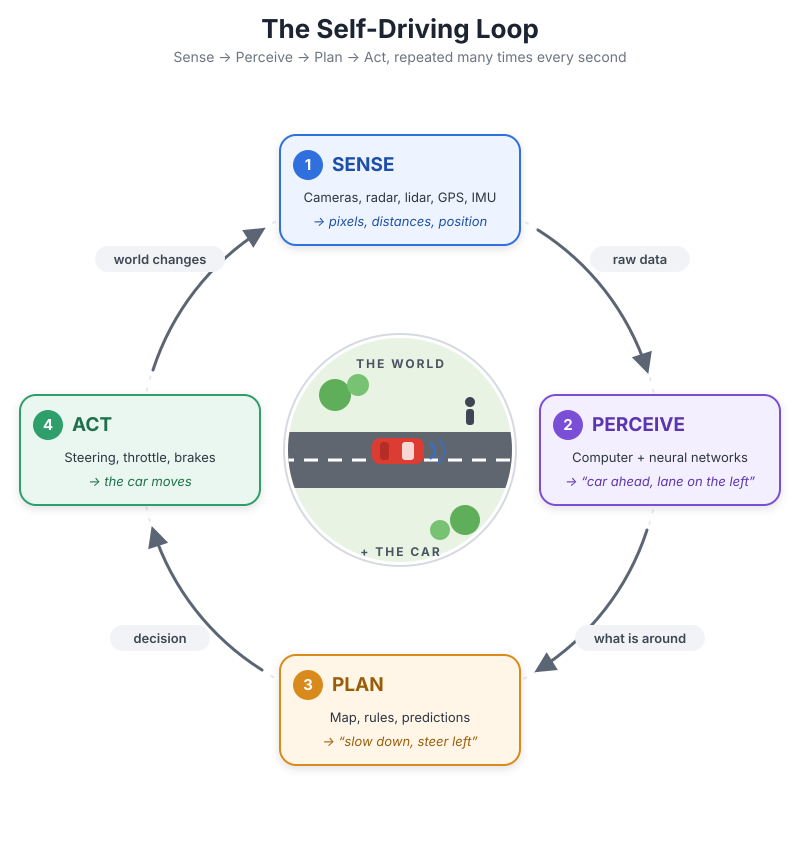
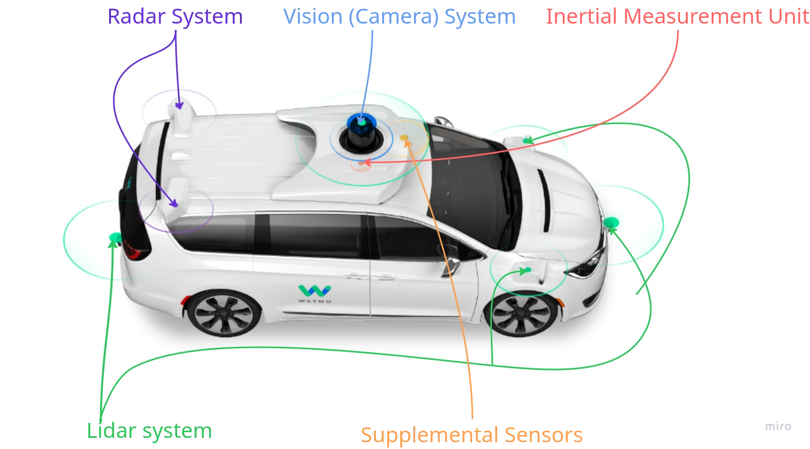

# Week 1 Research Notes

## Step 1 · The self-driving loop

| Step | What a human driver uses | What a self-driving car uses | What goes in → what comes out |
|---|---|---|---|
| **Sense** | Eyes (also ears and the sense of balance/motion) | Cameras, radar, lidar, ultrasonic sensors, GPS, IMU | Light, radio waves and sound from the world → raw data (images, distances, point clouds, position) |
| **Perceive** | The brain | The onboard computer running perception software (neural networks) | Raw data → meaning: objects, their size, speed and direction, lane lines, signs. The human brain receives electrical signals from the eyes and turns them into useful information; the car's computer does the same with data from its cameras, radars and lidars. |
| **Plan** | The brain: past experience, traffic rules, choosing the right reaction to a situation | Planning software on the computer: map, route, traffic rules, predictions of what other road users will do | Understood scene + goal → a decision ("steer a little left", "slow down and stop") |
| **Act** | Hands and feet | Drive-by-wire: the computer sends electronic commands to the steering motor, throttle and brakes | Decision → movement (steering angle, acceleration, braking). Motors and actuators are to the car what muscles are to a human. |

**Note on Plan:** the quality of planning depends on the software. Two cars with the same hardware can behave very differently: one with simple software, the other with a well-trained AI and well-structured code. In an emergency a human can panic or lose orientation, while a self-driving car can follow a well-thought-out procedure to minimise the damage.

### Loop diagram

### Questions

**1. What happens if the perceive step is wrong, for example it sees a shadow as an obstacle?**

The computer may think the shadow is a real object, for example a car. It may stop and wait for the "object" to move, or try to drive around it. Sudden braking for nothing (engineers call it *phantom braking*) is dangerous too: the car behind can crash into us. The opposite mistake is even worse: if the model thinks a real dark object is just a shadow, the car will drive into it. To avoid this, the computer-vision model must be trained to tell shadows from real objects, and other sensors (radar, lidar) can confirm whether something is really there.

**2. What happens if the whole loop is slow, for example it runs only twice a second?**

The car decides only every 0.5 seconds. At 50 km/h (about 14 m/s) it drives about 7 metres "blind" between two decisions. If a child runs onto the road during that time, the car cannot react in time, and it also cannot steer smoothly, so it swings from side to side. That is why the whole loop (sensors, computer and control) must run many times per second, usually tens of times.

**3. Which of the four steps do you think is the hardest to get right, and why?**

I think the hardest step is **perceive**, and many engineers agree. All the other steps are built on it: if the car makes a mistake here, planning and acting become useless, because they work with a wrong picture of the world. And the real world is chaotic: millions of unpredictable situations can happen on a real road (strange objects, shadows, rain, unusual behaviour of people), and we cannot list them all in advance. So although every step of a product that can endanger people's lives needs the highest attention, perception needs special attention.

---

## Step 2 · Sensors

### How lidar works

Lidar builds a 3D map of the world (a *point cloud*) using laser light. It shows objects, their size and how far away they are. If it scans continuously, it also shows which direction they are moving and how fast.

How it works: a laser sends out short pulses of light. The light reflects off surrounding objects, and part of it returns to the sensor. A detector measures the time between sending the pulse and receiving it back. Since light travels at a known speed, the distance is: **distance = (speed of light × time) / 2** (divided by 2 because the light travels there and back). The lidar measures millions of points every second, and together they form a detailed 3D map of the surroundings.

### Sensor table

| Sensor | What it measures | How it works (one sentence) | Typical range | Strong at | Fooled or blinded by | Rough price |
|---|---|---|---|---|---|---|
| **Camera** | Light: colour and brightness → images of the world | Photons hit the camera sensor (matrix), which records the colour and brightness of each pixel; many pictures per second (FPS) make a video. | Up to ~250 m (depends on the lens and camera quality) | Recognising things by look: traffic lights, signs, lane lines, people. With a powerful computer-vision system it can recognise almost everything it sees. | Rain, snow, fog, darkness, glare from the sun, a dirty lens: anything that stops light from reaching the sensor | Cheap |
| **Radar** | Distance and speed of objects | The car sends radio waves (~77 GHz, older ones 24 GHz) and the antenna receives the reflection; FMCW radar compares the frequency of sent and received waves to get distance and speed. | Up to ~250 m (car radars) | Working where cameras fail: rain, fog, darkness; measures speed directly | Interference from other radars; metal objects (bridges, manhole covers) can create false "ghost" objects; low resolution, so it cannot see shape well | Cheap–medium (~$50–200 for a car radar) |
| **Lidar** | Distance to millions of points → a 3D point cloud | Sends many laser pulses and measures the time until each one reflects from a surface and comes back. | ~200–300 m | Building a very accurate 3D map of the world, day and night | Heavy rain, fog, snow and dust scatter the laser; black or mirror-like surfaces reflect badly. (Mechanical lidars can also wear out and are sensitive to vibration.) | Expensive (hundreds to thousands of $) |
| **Ultrasonic** | Distance to nearby objects | Sends ultrasound pulses and computes the distance from the time the echo takes to come back. | ~0.2–5 m | Short distances (parking), simple and cheap design | Soft materials that absorb sound (snow, fabric), thin poles, dirt or ice on the sensor. It only gives distance: it cannot recognise objects or build a 3D map. | Cheap |
| **GPS / GNSS** | The car's position on Earth (and exact time) | Satellites with atomic clocks send radio signals with the time; the receiver measures how long each signal took from at least 4 satellites and calculates its position. More satellites = better accuracy. | Works anywhere on Earth with an open sky; accuracy ~3–5 m (a few cm with RTK correction) | Knowing where the car is on the map, anywhere in the world | Tunnels, tall buildings and anything that blocks or reflects the radio signals; jamming | Cheap (precise RTK receivers are expensive) |
| **IMU (accelerometer + gyroscope)** | The car's own acceleration and rotation | Tiny (micro) sensors have small movable parts; when the IMU moves, these parts move by inertia and the sensors detect it. | No "range": it measures the car's own motion in all 3 axes, hundreds of times per second | Measuring movement and rotation very fast; works everywhere, even in tunnels where GPS fails | Drift: small errors (bias) add up, so on its own it stays accurate only for a short time (seconds to minutes) | Cheap (high-precision ones are expensive) |

### Sensors on a real car: Waymo

*Source: Waymo, "Our Vehicle Sensors" (Waymo Safety Report, waymo.com/safety)*

**Why each sensor sits where it does**

Each sensor position has its own purpose. Waymo also makes sure that every direction around the car is covered by at least two sensors, so if one fails, another one still sees that zone.

- **Cameras and long-range lidar (roof dome):** the higher a sensor is, the farther it sees. From the roof the car can see that not only the first car ahead is stopping, but also the second and third, so it can brake even before the car in front of it does. The roof is also cleaner: there is less dirt from the road than at the bumpers. And the roof is the only place where a sensor can see all 360° around the car; anywhere else the car's own body blocks 90–180° of the view.
- **Short-range lidars (front and rear bumpers, sides near the front wheels):** placing sensors on the roof creates a new problem: in every direction there is a blind zone of about 1–3 metres right next to the car. If a child runs in front of the car, neither the roof cameras nor the roof lidar can see them. These lidars close all the blind zones. They do not see as far as the roof sensors, but they do not need to: their job is to detect everything close to the car.
- **Radars (rear corners of the roof):** each corner radar watches two sides at once: behind the car and the left or right side. This is important when changing lanes, and together the two radars make sure each zone is covered by at least two sensors.
- **GPS (roof):** the roof is the best place to receive signals from satellites, because nothing blocks the open sky.
- **IMU (inside the roof unit):** the IMU does not need to see anything; it measures the car's own movement and rotation. It sits in the same unit as the cameras and lidar, so it moves together with them, and the computer can use it to correct their data while the car is moving.
- **Microphones (supplemental sensors):** they let the car hear sirens and other sounds from any direction. With several microphones the car can also tell which side the sound is coming from.

### How Waymo drives: four questions

[Open as PDF](diagrams/waymo-how-it-drives.pdf)

### Essay: cameras only, or cameras plus lidar and radar?

**For cameras only (Tesla).** Tesla drives with cameras only. Its argument: a human drives using only eyes and a brain, so a machine can do the same. Tesla has never used lidar in its cars and later also removed radar and ultrasonic sensors. This makes the cars cheaper and gives them fewer parts that can break. Instead, Tesla makes its software stronger, so that cameras can recognise even more than human eyes can.

**For cameras plus lidar and radar (Waymo).** Cameras alone bring more complexity. When visibility is low (fog, heavy rain, darkness, sun glare), cameras become almost useless, while radar can still help the car drive. Each sensor solves its own problem, and they depend on each other, so without one of them the car becomes less safe. For example, a camera cannot measure the distance to an object directly: the car must estimate it with a very heavy ML model, which is harder and less accurate than a lidar measuring it directly.

**My opinion.** I find the combination of cameras, lidar and radar more convincing. The sensors cover each other's weak points, and if one of them is blinded, the others still see the road. That matters more than the lower price, because a mistake can cost a life. The same idea goes beyond these three sensors: without GPS and an IMU, the car could not easily know where it is and which way it is heading.

### Which real sensor is my Week 2 car's sensor most like?

My simulated car's sensors only check whether the floor just ahead is dark (on the line) or light (off the line). They do not measure distance; they measure the brightness of one point. So they are most like a **camera with just one pixel**, or the simple infrared light sensors used on real line-following robots. Based on this information the car can follow the line and does not leave the track.

---

## Step 3 · Levels of automation (SAE J3016)

| Level | Name | Who steers and brakes? | Who must watch the road? | Who handles an emergency? | One real example |
|---|---|---|---|---|---|
| **0** | No driving automation | Human | Human | Human (the car can only warn or brake for a moment) | Lane departure warning, automatic emergency braking (AEB) |
| **1** | Driver assistance | Human + system helps with **one** task (steering **or** speed) | Human | Human | Adaptive cruise control |
| **2** | Partial driving automation | System (steering **and** speed at the same time) | Human, all the time | Human | Tesla Autopilot / FSD (Supervised) |
| **3** | Conditional driving automation | System, in limited conditions (traffic jams, highways) | System (the human may look away) | Human, when the system asks them to take over | Mercedes-Benz Drive Pilot |
| **4** | High driving automation | System, only inside its prepared zone | System | System | Waymo One robotaxi, Baidu Apollo Go, Zoox |
| **5** | Full driving automation | System, everywhere | System | System | None exists yet |

### What each level means

**Level 0 · No driving automation.** A human drives the car. The car only has features that warn the driver or help for a moment in an emergency: for example, a warning when the car is leaving its lane, or automatic emergency braking (AEB) when the car is about to crash into something in front of it. Such systems are not very hard to build, because they do not need to understand heavy traffic: they only track a few simple things.

**Level 1 · Driver assistance.** The system does only one task: for example, it keeps a safe distance from the car in front (adaptive cruise control), or it keeps the car inside the lane lines. It performs one of these tasks and no more; the human does everything else.

**Level 2 · Partial driving automation.** The car controls the steering wheel and the speed at the same time by itself, for example Tesla Autopilot / FSD (Supervised). But even though the car can drive by itself, the human must watch the road all the time and is responsible for the driving.

**Level 3 · Conditional driving automation.** The car can drive by itself in certain conditions, for example in a traffic jam or on a highway. The driver can take their hands off the steering wheel and stop watching the road, but must be ready at any moment to take the wheel when the car asks. This is one of the hardest problems in self-driving engineering. A person who has been reading or watching a film needs several seconds to understand what is happening on the road, so the car must notice a problem early and warn the driver in time. And if the driver does not respond, the car must have a plan to stop the trip safely by itself.

**Level 4 · High driving automation.** The car drives by itself without a human. Cars of this level may not even have a steering wheel. The limit is that the car can drive only inside special zones (geofenced areas) that were prepared and tested beforehand, for example Waymo One, Baidu Apollo Go or Zoox robotaxis. Inside its zone the car must handle every unexpected situation by itself, for example understand the signals of a traffic police officer. In practice this needs very accurate lidars, radars and ML models that understand the real world.

**Level 5 · Full driving automation.** A Level 5 car would have to drive everywhere a human driver can, in any weather and on any road, with no limits on where it works. Cars of this level do not exist yet.

### Five real products by SAE level

- **Ordinary adaptive cruise control: Level 1.** It controls only one task, the speed and distance to the car in front, while the driver steers.
- **Tesla Full Self-Driving (Supervised): Level 2.** It steers and controls speed at the same time, but Tesla says the driver must keep watching the road and be ready to take over at any moment; that is what "Supervised" means.
- **comma.ai openpilot: Level 2.** Like Tesla, it steers and controls speed together, but it uses a driver-facing camera to check that the driver keeps looking at the road.
- **Mercedes-Benz Drive Pilot: Level 3.** On approved highways in traffic jams, at limited speed, the driver may look away from the road (for example, watch a film on the car's screen), but must take over when the car asks.
- **Waymo robotaxis: Level 4.** There is nobody in the driver's seat at all, but the cars drive only inside the cities and zones Waymo has mapped and tested.

### Why is Level 3 the trickiest level for humans?

At Level 3 the car drives itself, so the person is allowed to stop watching the road and, for example, read a book. But when the car meets a situation it cannot handle, it asks the person to take over within a few seconds. A person who was reading needs time to look up, understand where they are, what the other cars are doing and why the car is asking for help, and those few seconds may not be enough. People also quickly start to trust the system too much and stop paying attention, which makes the handover even harder. At Level 2 the driver is always watching, and at Level 4 the car never needs the driver, so only Level 3 depends on a sudden switch from a relaxed passenger to a responsible driver.

